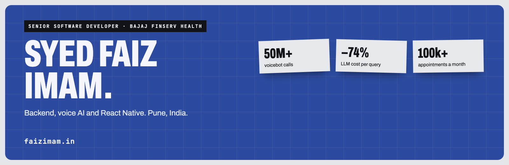

<a href="https://faizimam.in">
  <picture>
    <source media="(prefers-color-scheme: dark)" srcset="assets/banner-dark.png">
    
  </picture>
</a>

**[faizimam.in](https://faizimam.in)** &nbsp;·&nbsp; [Résumé](https://faizimam.in/resume) &nbsp;·&nbsp; [LinkedIn](https://www.linkedin.com/in/faiziimam/) &nbsp;·&nbsp; [Medium](https://medium.com/@faizkalwara) &nbsp;·&nbsp; [Say hello](https://faizimam.in/#contact)

## Hi, I'm Faiz Imam

Syed Faiz Imam, Senior Software Developer at **Bajaj Finserv Health** in Pune. I'm from Muzaffarpur, Bihar, and I build the backends millions of people talk to, cut what they cost to run, and ship the React Native apps on top.

> **Open to** React Native, backend and frontend roles · Pune, remote or relocating · I reply within a day

### Case files

| | System | In numbers |
| :-- | :--- | :--- |
| 01 | **[Voicebot platform](https://faizimam.in/work/voice)**: the backend of automated healthcare calls, moved from a polled database table to Kafka | 50M+ calls · −40% latency at 2× traffic |
| 02 | **[GPT-4o out, a fine-tuned model in](https://faizimam.in/work/llm)**: Qwen2.5-VL 32B trained on production queries | ₹0.30 → ₹0.078 a query · −74% · 95% accuracy |
| 03 | **[DRx, the clinic app](https://faizimam.in/work/drx)**: React Native for doctors and receptionists: Add Appointment, bulk WhatsApp, My Chats | 195 merged PRs · 100k+ appointments a month |
| 04 | **[Sales portal](https://faizimam.in/work/rm)**: doctor discovery, AI pitches, meetings and lab bookings on one backend | +25% sales efficiency |
| 05 | **[Vehicle damage detection](https://faizimam.in/work/damage)**: a vision LLM plus a custom model for motor claims | module owner · in progress |
| 06 | **[Bluetooth wellness kiosk](https://faizimam.in/work/kiosk)**: React Native and a BLE body-composition scale | 22 readings · 600+ entries |

**[Open the case files and watch them run →](https://faizimam.in/#systems)**

### Stack

         

### Off-call

Cricket (a bowling all-rounder, right-arm off-spin), Netflix, and books: *The Count of Monte Cristo* is the favourite. Coding lofi on repeat, a guitar on the balcony, and Ladakh by bike as the best trip so far. **[The longer story →](https://faizimam.in/about)**

Sharp Shark Award ×2 · Limelight · Stellar Squad &nbsp;·&nbsp; B.Tech CSE, SRM Institute of Science and Technology &nbsp;·&nbsp; <a href="https://faizimam.in">faizimam.in</a>

