<a href="https://faizimam.in">
  <picture>
    <source media="(prefers-color-scheme: dark)" srcset="assets/banner-dark.svg">
    
  </picture>
</a>

<div align="center">

**[faizimam.in](https://faizimam.in)** &nbsp;·&nbsp; [LinkedIn](https://www.linkedin.com/in/faiziimam/) &nbsp;·&nbsp; [Medium](https://medium.com/@faizkalwara) &nbsp;·&nbsp; [Say hello](https://faizimam.in/#contact)

</div>

# Hi, I'm Syed Faiz Imam

Most people call me **Faiz Imam**. I'm a Senior Software Developer in Pune, India, and I build backends that talk to millions of people: voice AI, event-driven systems on Kafka, LLM pipelines, and the React Native apps that sit on top.

```http
GET /faiz HTTP/2
host: faizimam.in

HTTP/2 200 OK
x-name:      Syed Faiz Imam (Faiz Imam)
x-role:      Senior Software Developer
x-location:  Pune, India
x-stack:     Node.js, TypeScript, Kafka, LLMs, React Native
x-off-call:  books, cricket, guitar, PS5
```

### `GET /systems`

| System | What I built |
| :--- | :--- |
| **Voicebot platform** | The backend of an automated healthcare calling system. Call jobs moved from a database table to Kafka, so workers scale out and retries never block the queue. |
| **Vision LLM migration** | Replaced a hosted model with a fine-tuned open vision-language model for the same job, checked against the old answers before any traffic moved. |
| **Vehicle damage detection** | Module owner of a system that finds and grades car damage from photos, using a vision LLM and a custom model together. |
| **Sales portal** | One tool for relationship managers: nearby doctors, an AI-written pitch, meetings, lab bookings and tickets. |
| **Patient app and wellness kiosk** | React Native: appointment booking and patient journeys, plus a tablet kiosk that reads a Bluetooth body-composition scale. |

**[Open the systems and watch them run →](https://faizimam.in/#systems)**

### `GET /stack`

         

### `GET /off-call`

Off the clock I read (history, philosophy, a lot of fiction), play cricket, pick at a guitar, and lose hours on the PS5. **[The off-call side of me →](https://faizimam.in/life)**

<div align="center">

<sub>end of response · <a href="https://faizimam.in">faizimam.in</a></sub>

</div>
